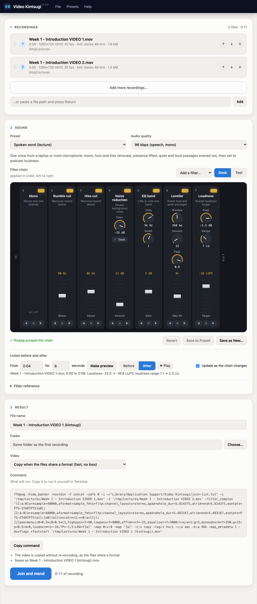

<p align="center"></p>

# Video Kintsugi

Video Kintsugi is a small Mac app for fixing the sound of recorded lectures and talks. It can also join a recording that was saved in parts. It runs [FFmpeg](https://ffmpeg.org) on your Mac from a page in the browser:

- **One recording:** the sound is cleaned up and the video is copied unchanged.
- **Two or more:** they are joined in the order listed and the sound is cleaned up in the same pass. When the files share a video format (as the parts of one recording do), the video is copied without re-encoding, so a two-hour lecture takes a minute or two. Files that differ are re-encoded with VideoToolbox to match the first.

The originals are never changed. The result is saved beside the first recording as `name (kintsugi).mov` unless you choose another name or folder, and it never replaces an existing file.

<p align="center"></p>

## The sound

The sound goes through a chain of FFmpeg audio filters, shown as a mixing desk with one channel strip per filter, worked from left to right. Each strip has a light that switches it on or off, knobs for its settings and a fader for its main one. Knobs turn by dragging up or down (hold Shift for fine control), by scrolling or with the arrow keys; a double-click resets a knob or fader. **Add a filter** puts a new strip before the final loudness stage. The **Text** view shows the same chain as FFmpeg reads it, one filter per line, and can be edited directly; a line starting with `#` is bypassed.

**Listen before and after** renders a short clip from any point in the recording twice, untouched and through the chain, with the loudness of each. While *Update as the chain changes* is ticked, the preview is made again whenever a knob or fader moves, and playback carries on from the same place.

The presets are starting points:

| Preset | For |
|---|---|
| Spoken word (lecture) | One voice from a laptop or room microphone: mono, rumble and hiss removed, presence lifted, levels evened out, set to −16 LUFS |
| Spoken word, noisy room | The same, with stronger noise reduction that follows changing noise (fans, air conditioning) |
| Speaker far from the microphone | Heavier levelling for a speaker who moves about or turns away |
| Discussion, several voices | Keeps stereo; gentler levelling across loud and quiet speakers |
| Light clean-up | Stereo, rumble and faint hiss removed, loudness set |
| Loudness only | Brings the whole recording to a standard loudness |
| No change (join only) | Copies the sound as it is when the files allow it |

Changes can be saved to a preset or as a new one (**Presets** menu). Presets are kept in `~/Library/Application Support/Video Kintsugi/presets.json`; **Restore Built-in Presets** brings the originals back and keeps your own.

The **Command** box shows the exact FFmpeg command that will run, with a button to copy it for use in Terminal.

## Installing

Requirements: macOS with [Homebrew](https://brew.sh), and FFmpeg:

```bash
brew install ffmpeg
```

Clone the repository and build the app:

```bash
git clone https://github.com/dmberry/video-kintsugi.git ~/Projects/video-kintsugi
```

```bash
~/Projects/video-kintsugi/make-app.sh
```

This makes **Video Kintsugi** in `~/Applications` and a Finder Quick Action of the same name: select one or more videos in Finder, right-click, and choose **Quick Actions › Video Kintsugi** to open them in the app.

Double-click **Video Kintsugi** to start it. It runs a server on `http://127.0.0.1:8767/` (standard-library Python, no packages) and opens the page. The server stops after 15 minutes with no page open and nothing running, or from **File › Quit Video Kintsugi**. Logs go to `~/Library/Logs/Video Kintsugi.log`. The first time it opens a file in Downloads, Desktop or Documents, macOS asks for permission.

The server listens on 127.0.0.1 only, refuses requests with a foreign `Host` header, and refuses write requests without its own header.

## Files

| File | Role |
|---|---|
| `kintsugi.py` | local server: probing files, building the FFmpeg command, running the job, previews, presets |
| `index.html`, `app.js` | the page |
| `desk.js` | the filter chain as a mixing desk |
| `launch.sh`, `make-app.sh` | start the server and open the page; build the `.app` and the Quick Action |
| `quick-action/` | the Finder Quick Action template |
| `branding/` | icon, screenshot and the headless-Chrome script used to take it |

## Licence

Video Kintsugi is free software, released under the [GNU General Public License, version 3](LICENSE).

## Credits

Created by David M. Berry. © 2026 David M. Berry.

FFmpeg by the FFmpeg developers.
