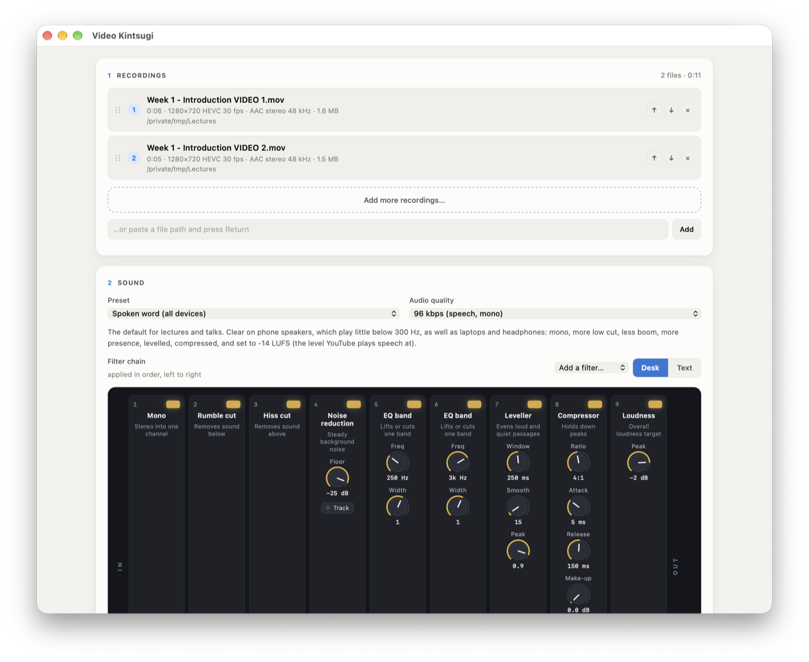

<p align="center"></p>

# Video Kintsugi

Video Kintsugi fixes the sound of recorded lectures and talks, and joins a recording that was saved in parts. It is a Mac app that drives [FFmpeg](https://ffmpeg.org) on your own machine; nothing is uploaded. The same interface can also run in your web browser instead of its own window.

- **One recording:** the sound is cleaned up and the video is copied unchanged.
- **Two or more:** they are joined in the order listed and the sound is cleaned up in the same pass. When the files share a video format (as the parts of one recording do), the video is copied without re-encoding, so a two-hour lecture takes a minute or two. Files that differ are re-encoded with VideoToolbox to match the first.

The originals are never changed. The result is saved beside the first recording as `name (kintsugi).mov` unless you choose another name or folder, and it never replaces an existing file.

<p align="center"></p>

## The sound

<p align="center"></p>

The sound goes through a chain of FFmpeg audio filters, shown as a mixing desk with one channel strip per filter, worked from left to right. Each strip has a light that switches it on or off, knobs for its settings and a fader for its main one. Knobs turn by dragging up or down (hold Shift for fine control), by scrolling or with the arrow keys; a double-click resets a knob or fader. **Add a filter** puts a new strip before the final loudness stage. The **Text** view shows the same chain as FFmpeg reads it, one filter per line, and can be edited directly; a line starting with `#` is bypassed.

**Listen before and after** renders a short clip from any point in the recording twice, untouched and through the chain, with the loudness of each. While *Update as the chain changes* is ticked, the preview is made again whenever a knob or fader moves, and playback carries on from the same place.

**Loudness.** When the chain ends with a Loudness strip, the job runs in passes. It measures the whole recording through the chain, applies the gain that reaches the target with a limiter holding the peaks below the ceiling, measures again and adjusts until the result is within 0.3 LU of the target (the limiter takes back more as the gain rises), then writes the file and measures the finished file. FFmpeg's own single-pass `loudnorm` undershoots on long speech recordings: a lecture aimed at −16 LUFS came out at −17.5 with peaks over 0 dBFS. While the job runs, the window shows the steps and two loudness lanes across the recording, the original in grey and the result in gold, against the target.

The presets are starting points:

| Preset | For |
|---|---|
| **Spoken word (all devices)** — the default | Lectures and talks for viewers on phones, laptops or headphones: mono, more low cut, less boom, more presence, levelled, compressed, set to −14 LUFS (the level YouTube plays speech at) |
| Spoken word, podcast level | One voice set to −16 LUFS, the level podcast platforms expect; quieter on phones |
| Spoken word, compressed | The podcast-level preset with a compressor after the levelling, to catch sudden peaks such as laughs, coughs or a raised voice |
| Spoken word, noisy room | Stronger noise reduction that follows changing noise (fans, air conditioning) |
| Speaker far from the microphone | Heavier levelling for a speaker who moves about or turns away |
| Discussion, several voices | Keeps stereo; gentler levelling across loud and quiet speakers |
| Light clean-up | Stereo, rumble and faint hiss removed, loudness set |
| Loudness only | Brings the whole recording to a standard loudness |
| No change (join only) | Copies the sound as it is when the files allow it |

Changes can be saved to a preset or as a new one (**Presets** menu). Presets are kept in `~/Library/Application Support/Video Kintsugi/presets.json`; **Restore Built-in Presets** brings the originals back and keeps your own.

The **Command** box shows the exact FFmpeg command that will run, with a button to copy it for use in Terminal.

## Installing

Requirements: macOS 12 or later, Apple's command line tools (`xcode-select --install`, which also provides Python 3), and FFmpeg, most easily from [Homebrew](https://brew.sh):

```bash
brew install ffmpeg
```

Clone the repository and build the app:

```bash
git clone https://github.com/dmberry/video-kintsugi.git ~/Projects/video-kintsugi
```

```bash
~/Projects/video-kintsugi/make-app.sh
```

This compiles **Video Kintsugi** into `~/Applications` and adds a Finder Quick Action of the same name. To open recordings in it:

- drag them onto the window or the Dock icon;
- select them in Finder, right-click, and choose **Quick Actions › Video Kintsugi** or **Open With › Video Kintsugi**;
- or use **File › Add Recordings…** (⌘O).

If FFmpeg is missing, the window says so and gives the commands to install it (with a button that runs the Homebrew install in Terminal), and carries on once FFmpeg is found. The first time it opens a file in Downloads, Desktop or Documents, macOS asks for permission. Logs go to `~/Library/Logs/Video Kintsugi.log` (**Help › Show Log**).

### In the browser instead

The original version runs the same page in your web browser:

```bash
~/Projects/video-kintsugi/make-app.sh --browser
```

This makes **Video Kintsugi (Browser)** in `~/Applications`; `launch.sh` does the same from Terminal. The Mac app can also hand its page to the browser with **View › Open in Browser**. Both use one server on `http://127.0.0.1:8767/` when both are open. Started from the browser version, the server stops after 15 minutes with no page open and nothing running.

### How it is built

The app is a native window (`mac/VideoKintsugi.swift`, AppKit and WebKit) around the page. It starts the server, `kintsugi.py` (standard-library Python, no packages), from inside the app bundle and stops it on quit. The server listens on 127.0.0.1 only, refuses requests with a foreign `Host` header, and refuses write requests without its own header.

## Files

| File | Role |
|---|---|
| `kintsugi.py` | local server: probing files, building the FFmpeg command, running the job, previews, presets |
| `index.html`, `app.js` | the page |
| `desk.js` | the filter chain as a mixing desk |
| `mac/` | the Mac app: `VideoKintsugi.swift` (window, menus, Finder drag and drop, Open With) and its `Info.plist` |
| `make-app.sh` | build the Mac app (or, with `--browser`, the browser launcher) and the Quick Action |
| `launch.sh` | start the server and open the page in the browser |
| `quick-action/` | the Finder Quick Action template |
| `branding/` | icon and screenshots (taken by the app itself: run it with `KINTSUGI_SCREENSHOT=out.png`, optionally `KINTSUGI_SCREENSHOT_SIZE=1040x880` and `KINTSUGI_SCREENSHOT_JS` to set the page up) |

## The name

Kintsugi (金継ぎ, “golden joinery”) is the Japanese craft of repairing broken pottery with urushi lacquer mixed or dusted with powdered gold. A story often told about its origin concerns the shogun Ashikaga Yoshimasa, who in the fifteenth century is said to have sent a cracked Chinese tea bowl away for repair and received it back held together with metal staples, which led craftsmen to look for a finer method. The repair is left in view: the gold follows the line of each break, so the object's history, including its damage, remains part of how it looks. The practice is often linked to *wabi-sabi*, an aesthetic of the imperfect and impermanent, and to *mottainai*, regret at waste.

Video Kintsugi applies the idea to recordings: it joins a lecture saved in several parts and repairs its sound, so that a flawed recording can still be used. The gold seam in the logo marks the join.

## Licence

Video Kintsugi is free software, released under the [GNU General Public License, version 3](LICENSE).

## Credits

Created by David M. Berry. © 2026 David M. Berry.

FFmpeg by the FFmpeg developers.
